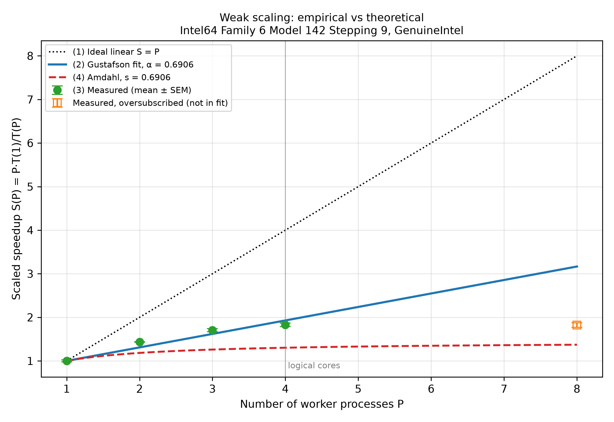

# Task 24 — Empirical vs. Theoretical Scaling and Hardware Audit

> **Fill in the `<<…>>` values** from the output of `benchmarks/fit_gustafson.py` (or from `benchmarks/fit_result.json`) after running the benchmark on your own machine.

## 1. Plot

Vector version: [`plots/scaling_comparison.pdf`](../plots/scaling_comparison.pdf)

The plot shows:
1. the ideal linear speedup `S = P` (dotted),
2. the Gustafson curve with the fitted α (blue),
3. measured mean scaled speedup with standard-error bars (green; orange = oversubscribed),
4. Amdahl's curve with the same α (red dashed).

## 2. Hardware

| Item | Value |
|---|---|
| CPU | Intel 7th gen Core, "Kaby Lake-U" (Family 6, Model 142, Stepping 9), e.g. i5-7200U / i7-7500U — exact model: `<<from Task Manager → Performance → CPU>>` |
| Cores / threads | 2 physical / 4 logical (Hyper-Threading) |
| Base / turbo clock | `<<e.g. 2.5 / 3.1 GHz>>` |
| L1 cache | 32 KB data + 32 KB instruction per core |
| L2 cache | 256 KB per core |
| L3 cache | 3 MB (i5) or 4 MB (i7), shared |
| Memory | dual-channel DDR4-2133 / LPDDR3-1866 (Kaby Lake-U support), installed: `<<RAM size and speed>>` |
| Sockets / NUMA nodes | 1 socket, 1 NUMA node |
| TDP | 15 W (laptop) |
| OS / Python | `<<Windows version>>`, Python `<<version>>`, numpy `<<version>>` |

## 3. Results

| P | Mean T (s) | Std T (s) | Scaled S | E = S/P |
|---|---|---|---|---|
| 1 | `<<>>` | `<<>>` | 1.000 | 1.000 |
| 2 | `<<>>` | `<<>>` | `<<>>` | `<<>>` |
| 3 | `<<>>` | `<<>>` | `<<>>` | `<<>>` |
| 4 | `<<>>` | `<<>>` | `<<>>` | `<<>>` |
| 8 (oversub.) | `<<>>` | `<<>>` | `<<>>` | `<<>>` |

Fitted: **α_observed = `<<α>>` ± `<<SE>>`**, R² = `<<R²>>`

## 4. Why the measured points deviate from the theory

**a) Physical vs. logical cores (most important here).**
P = 1 and P = 2 use separate physical cores, so S should be close to 2. P = 3 and P = 4 put two processes on one core (Hyper-Threading). They share the same FP/AVX units and L1/L2 cache, so each process runs slower and S grows much less than 1 per extra process. The fitted α therefore mostly measures **SMT sharing**, not a real serial part of the code.

**b) Oversubscription (P = 8).**
There are only 4 hardware threads, so 8 processes take turns. The time roughly doubles and S stays at about the 4-thread value. This is time-sharing, not a serial fraction, so these points are excluded from the fit.

**c) Turbo boost and thermal throttling.**
With one busy core, the CPU can run at its max turbo clock. With all cores busy, the turbo clock is lower, and a 15 W laptop soon heats up and lowers the clock even more. So T(P) grows even with a perfectly parallel code. This makes α look bigger. Signs of throttling: run-to-run times go up over time, or the standard deviation is larger at high P.

**d) Memory bandwidth.**
The working set per worker (a few 8 MB chunks) is bigger than L3 (3–4 MB), so data streams from DRAM. Two memory channels are shared by all cores. When all cores stream at once, they compete for bandwidth.

**e) NUMA boundaries.**
This laptop has **one socket and one NUMA node**, so there is no NUMA penalty. On a dual-socket server, processes on the second socket would read memory attached to the other socket (slower), and S would drop when P crosses the socket boundary.

**f) Python / OS overhead.**
`pool.map` pickles the arguments and results and sends them through pipes. Windows also has background tasks. These costs are small here (only P tiny messages per run), but they add noise at small k.

## 5. Conclusion

Up to the number of physical cores, the measured scaled speedup is close to Gustafson's line. After that, Hyper-Threading, lower turbo clocks and heat make the measured α larger than the code's real serial fraction. Amdahl's curve with the same α is far lower, which shows again that for weak scaling the Gustafson model is the right reference.
